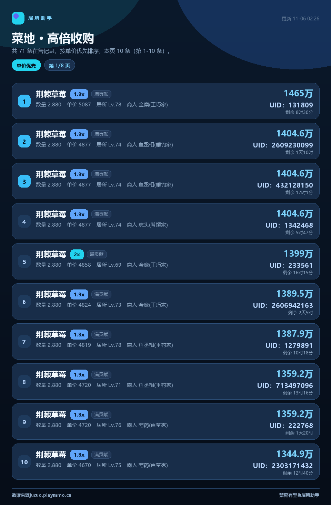
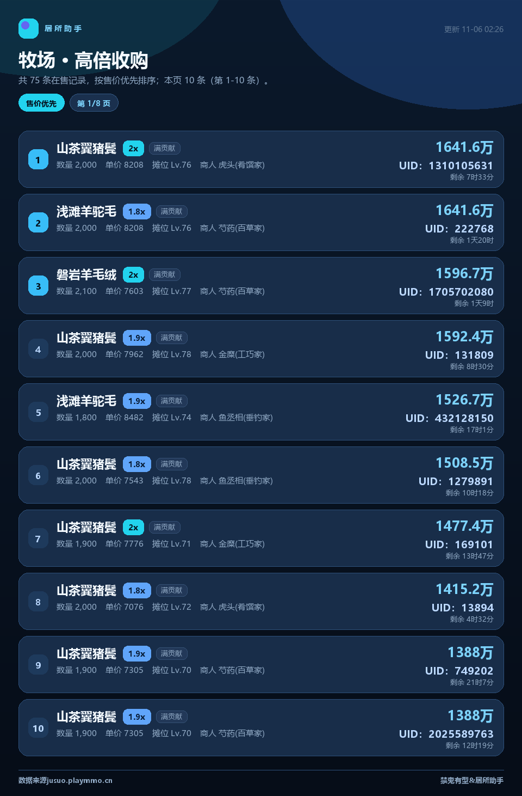
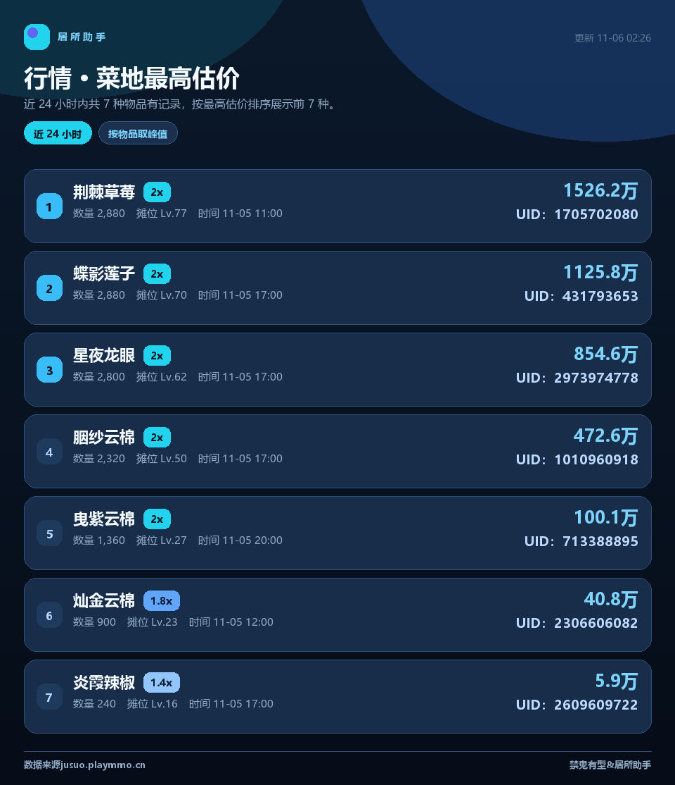
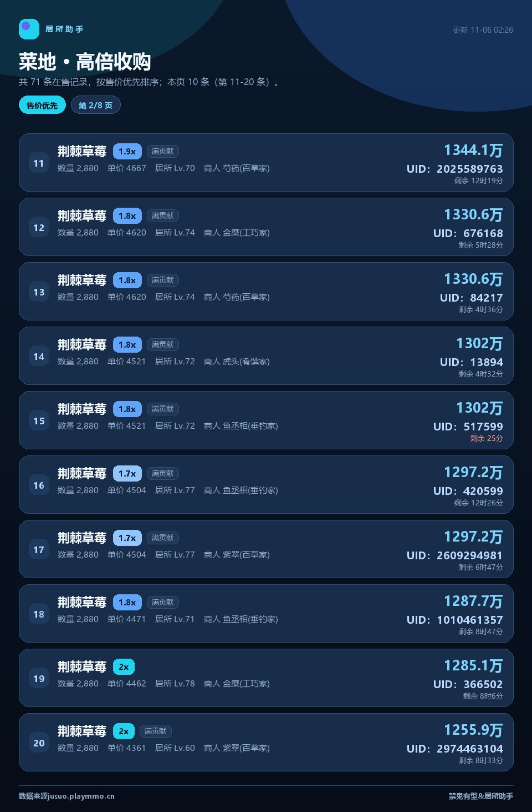
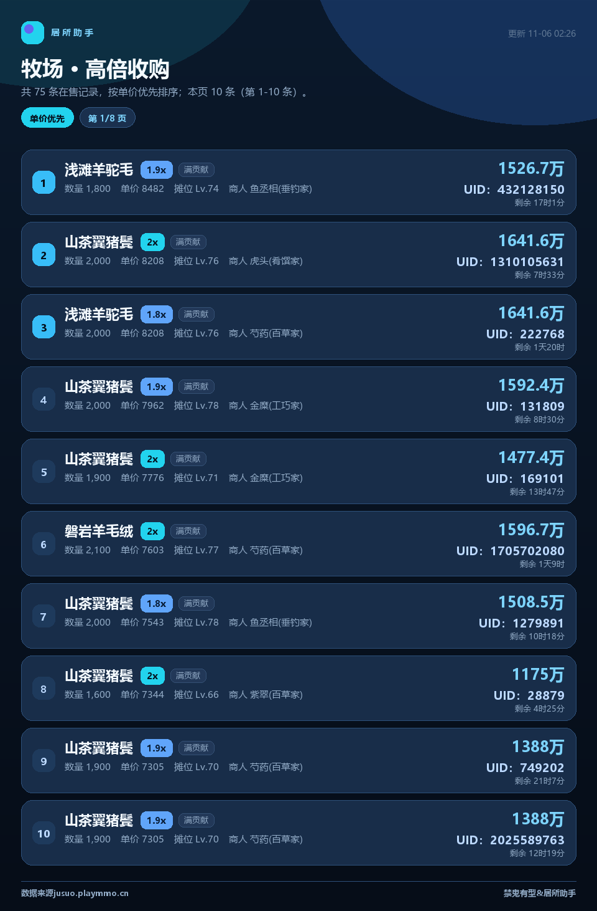

# 居所助手 · astrbot_plugin_jusuo

> 王者荣耀世界「居所助手」数据查询插件 —— 菜地/牧场高倍收购、物品清单、行情走势，本地出图，秒回。


数据来自玩家自发分享的 [jusuo.playmmo.cn](https://jusuo.playmmo.cn)，插件直连其公开只读接口，不经网页渲染，响应通常在 200ms 上下。

## 功能

- **`/菜地`、`/牧场`**：高倍收购列表，支持按物品名筛选、单价/售价两种排序、翻页；每条带商人 UID、等级、剩余时间与预估售价。
- **`/物品列表`**：一键列出两类当前在售的全部物品名，方便挑物品。
- **`/行情`**：近 N 小时各物品的最高成交估价峰值。
- **本地出图**：Pillow 直接绘制 960px 宽 PNG，深蓝配色、大字号，不联网、约 0.2 秒一张；绘制失败自动退纯文本。
- **只认 `/`**：不带斜杠的消息一律不触发，不会误抢普通聊天。

## 效果

| 菜地 · 售价优先 | 菜地 · 单价优先 |
| --- | --- |
|  |  |

| 牧场 · 售价优先 | 行情 · 近 24 小时 |
| --- | --- |
|  |  |

<details>
<summary>更多截图</summary>

| 翻页（第 2 页） | 牧场 · 单价优先 |
| --- | --- |
|  |  |

</details>

## 安装

**方式一：插件市场**（推荐）

在 AstrBot WebUI「插件 → 插件市场」搜索「居所助手」安装，或前往 [cloud.astrbot.app/publish](https://cloud.astrbot.app/publish) 查看。

**方式二：手动**

```bash
cd AstrBot/data/plugins
git clone https://github.com/towjf/astrbot_plugin_jusuo.git
```

**方式三：上传 zip**

把插件目录打包成 zip 上传，注意 `main.py`、`metadata.yaml` 要在压缩包**根层**（不要套一层文件夹）。

装好后在 WebUI 插件列表里启用即可。依赖只有 `Pillow` 与 `aiohttp`，都是 AstrBot 自带，无需额外安装。

## 命令

| 命令 | 说明 |
| --- | --- |
| `/菜地 [物品] [单价\|售价] [页数]` | 菜地作物高倍收购，默认**售价优先、第 1 页** |
| `/牧场 [物品] [单价\|售价] [页数]` | 牧场动物产物收购，规则同上 |
| `/物品列表` | 菜地 + 牧场在售物品名清单（纯文本） |
| `/行情 [菜地\|牧场] [小时]` | 行情峰值，默认**菜地、24 小时** |
| `/居所帮助` | 命令一览（图片） |
| `/居所测试` | 自检：接口连通性、出图方式、插件版本 |

示例：

```
/菜地                    → 全部物品，售价优先第 1 页
/菜地 草莓               → 只看名字含「草莓」的
/菜地 草莓 单价 2         → 草莓类，按单价排序第 2 页
/牧场 羊毛               → 只看羊毛类产物
/行情 牧场 48            → 牧场产物近 48 小时峰值
/物品列表                → 列出两类全部物品名
```

排序说明：

- **售价优先（默认）**：按整批预计售价排序；
- **单价优先**：按每件预计价格排序；
- 两种模式右侧大字都是**整批预计售价**，区别只在顺序；详情行始终带每件单价。

附加过滤（可选，默认不过滤）：`/菜地 倍率2 等级70 售价`。

## 配置

| 键 | 说明 | 默认 |
| --- | --- | --- |
| `use_image` | 出图开关，关掉则输出纯文本 | `true` |
| `default_sort_mode` | 默认排序：`sale` 售价优先 / `unit` 单价优先 | `sale` |
| `default_min_multiplier` | 默认倍率下限（0 = 不过滤） | `0` |
| `default_min_level` | 默认等级下限（0 = 不过滤） | `0` |
| `max_items` | 每页条数 | `10` |
| `hide_limited` | 排除已限购条目 | `true` |
| `fetch_limit` | 单次拉取条数 | `300` |
| `cache_ttl` | 基础数据缓存秒数 | `90` |
| `timeout` | 请求超时秒数 | `15` |
| `supabase_url` | 数据接口地址 | `https://db.playmmo.cn` |
| `anon_key` | 公开只读 key，留空用内置 | 空 |

## 数据与隐私

- 数据全部来自 `db.playmmo.cn` 的公开只读接口（前端内置的 anon key，仅具备 RLS 允许的读权限），插件不写入、不上传任何数据；
- 卡片在本地用 Pillow 绘制，图片不经过任何第三方渲染服务；
- 插件展示的商人 UID 等信息是站点本身公开的玩家分享内容，仅供游戏内找摊位使用；
- 估价按站点公式推算：`单价 ×(1+等级加成)× 倍率 × 数量 ×(1+满贡献0.2)`，与游戏内实际成交可能存在差异。

> 站点接口由第三方维护，若对方调整字段或鉴权，插件需要同步更新。欢迎提 issue。

## 开发

```
astrbot_plugin_jusuo/
├── main.py              # 命令注册与调度
├── core/
│   ├── api.py           # Supabase REST 客户端（重试 + 缓存）
│   ├── params.py        # 命令参数解析（纯函数，可单测）
│   ├── view.py          # 数据 → 卡片视图模型
│   ├── image.py         # Pillow 绘制（改配色/字号只动这里）
│   ├── text.py          # 纯文本兜底
│   └── format.py        # 金额、时间、估价公式
├── tests/               # 单元测试 + 出图预览脚本
└── docs/images/         # README 截图
```

```bash
# 跑单元测试（不需要 AstrBot）
python -m unittest discover -s tests -p "test_*.py"

# 抓真实数据出一堆预览图到 docs/images/
python tests/preview.py
```

CI（GitHub Actions）会对 Python 3.10 / 3.12 跑 ruff 与单元测试，并校验 `metadata.yaml` 必填字段。

## 更新日志

见 [CHANGELOG.md](CHANGELOG.md)。

## 免责声明

本插件为非官方工具，与游戏官方、`jusuo.playmmo.cn` 站点均无隶属关系；数据版权归原站点与分享玩家所有。请合理控制请求频率，因数据偏差造成的游戏内损失由使用者自行承担。

## License

[MIT](LICENSE)
